# Detector de gorras con YOLO11

Fine-tuning de YOLO11 para detectar **gorras con visera**, una clase que el modelo pre-entrenado en COCO no conoce.

| | |
|---|---|
| **Institución** | ISTEA |
| **Materia** | Aprendizaje Automático II |
| **Año / cuatrimestre** | 2026 — 2.º cuatrimestre |
| **Equipo** | Mauricio Chocholacek · Paola Lucia Pierolivo Fernandez · Veronica Andrea Gonzalez · Daiana Marilyn Ruiz Díaz · Andrea Romeo · Rodolfo Javier Berrone |
| **Entrega** | Trabajo Práctico 2 — Visión por Computadora · 13/11/2026 |

[](https://colab.research.google.com/github/javi2481/detector-gorras-yolo11/blob/main/notebooks/TP2_Detector_Gorras.ipynb)


[](LICENSE)

## Contenido

- [El proyecto en una imagen](#el-proyecto-en-una-imagen)
- [Cómo funciona](#cómo-funciona)
- [1. Los datos](#1-los-datos)
- [2. Línea de base](#2-línea-de-base-el-modelo-sin-entrenar)
- [3. Entrenamiento: A vs. B](#3-entrenamiento-a-vs-b)
- [4. Prueba final y análisis de errores](#4-prueba-final-y-análisis-de-errores)
- [Qué aprendimos](#qué-aprendimos)
- [Reproducir](#reproducir)
- [Estructura del repositorio](#estructura-del-repositorio)
- [El notebook, sección por sección](#el-notebook-sección-por-sección)
- [Equipo](#equipo)
- [Glosario rápido](#glosario-rápido)
- [Créditos](#créditos)
- [Licencia](#licencia)

## El proyecto en una imagen

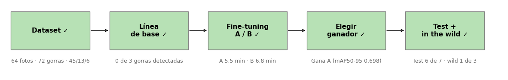

Con 64 fotos propias, pasamos de un modelo que **no veía ninguna gorra** a uno que encuentra **6 de 7** en test. Pero con fotos realmente nuevas encuentra **1 de 3**. Este README explica cómo llegamos a cada número y qué aprendimos de esa diferencia.

## Cómo funciona

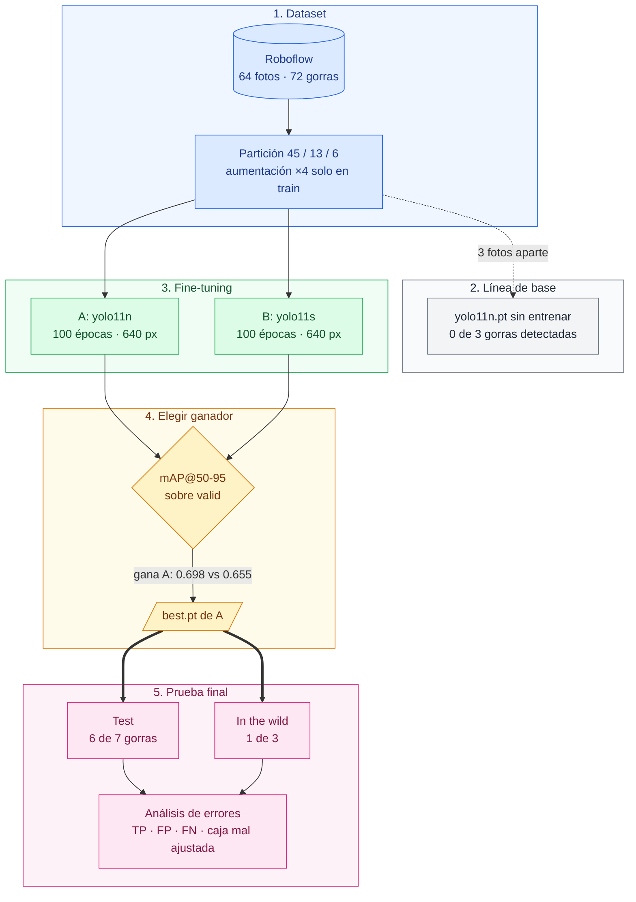

| Etapa | Pregunta que responde | Resultado |
|---|---|---|
| **1. Dataset** (azul) | ¿Qué le enseñamos? | 64 fotos, 72 gorras, una sola clase |
| **2. Línea de base** (gris) | ¿Hacía falta entrenar? | Sí: sin entrenar no detecta ninguna gorra |
| **3. Fine-tuning** (verde) | ¿Qué variante aprende mejor? | Dos modelos que solo difieren en el tamaño |
| **4. Elegir ganador** (amarillo) | ¿Con cuál seguimos? | A (`yolo11n`): ajusta mejor las cajas y pesa un cuarto |
| **5. Prueba final** (rosa) | ¿Funciona con fotos que no vio? | Test 6 de 7 · in the wild 1 de 3 |

## 1. Los datos

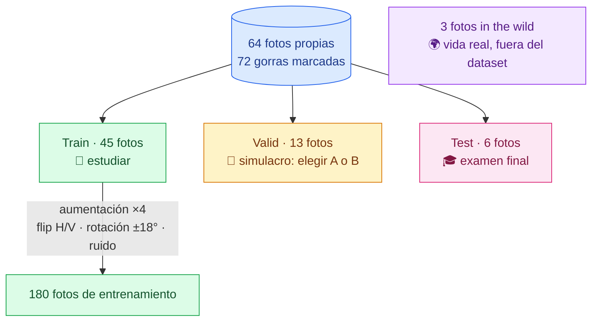

Cada grupo de fotos cumple un papel distinto, como un estudiante preparando un examen: con **train** estudia, con **valid** hace el simulacro (lo usamos para elegir entre A y B), **test** es el examen final con ejercicios del mismo libro, e **in the wild** es un problema de la vida real.

Las gorras se marcaron a mano en Roboflow con un criterio común: solo gorras con visera, un recuadro por gorra, y se marcan las tapadas o cortadas si se ve la mayor parte.

| Partición | Fotos originales | Imágenes en el export | Para qué se usa |
|---|---:|---:|---|
| Train | 45 | 180 (×4 por aumentación) | Entrenar |
| Valid | 13 | 13 | Elegir entre A y B |
| Test | 6 | 6 | Evaluación final |
| In the wild | 3 | — (fuera del dataset) | Probar con fotos realmente nuevas |

**Preprocesamiento:** orientación automática y *resize* (estirado) a 640x640. Las aumentaciones se aplican solo a train; valid y test quedan sin aumentar para evaluar con fotos reales.

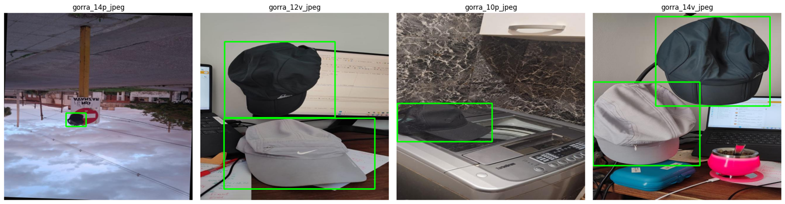

## 2. Línea de base: el modelo sin entrenar

`yolo11n.pt`, entrenado en COCO, ve la silla, la botella y las plantas, pero **ninguna gorra**: la ignora o la llama "person".

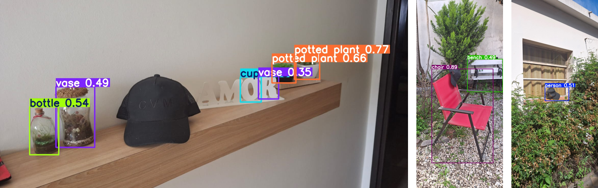

## 3. Entrenamiento: A vs. B

Se compararon dos configuraciones que cambian **un solo factor**, el tamaño del modelo. Todo lo demás es igual: 100 épocas, 640 px y semilla 42.

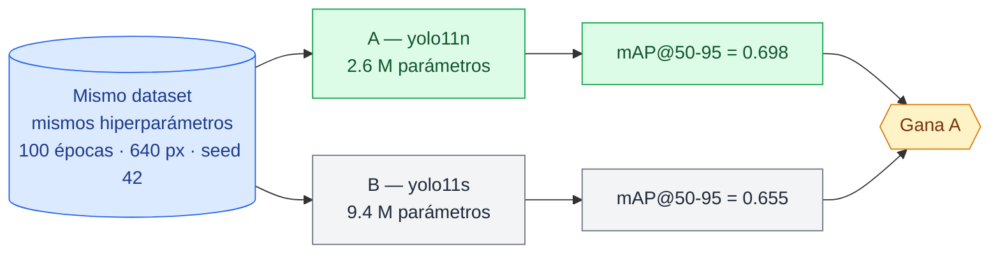

| Configuración | Precision | Recall | mAP@50 | mAP@50-95 | Tiempo (T4) | Tamaño |
|---|---:|---:|---:|---:|---:|---:|
| **A — yolo11n (ganador)** | 0.987 | 0.867 | 0.923 | **0.698** | 5.5 min | 5.5 MB |
| B — yolo11s | 0.982 | 0.867 | **0.970** | 0.655 | 6.3 min | 19.2 MB |

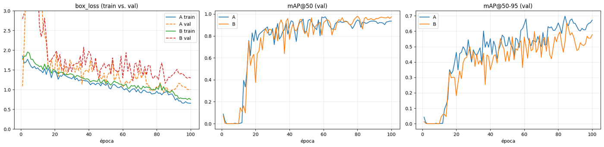

<details>
<summary>Ver el <code>results.png</code> completo de A (todas las pérdidas y métricas)</summary>

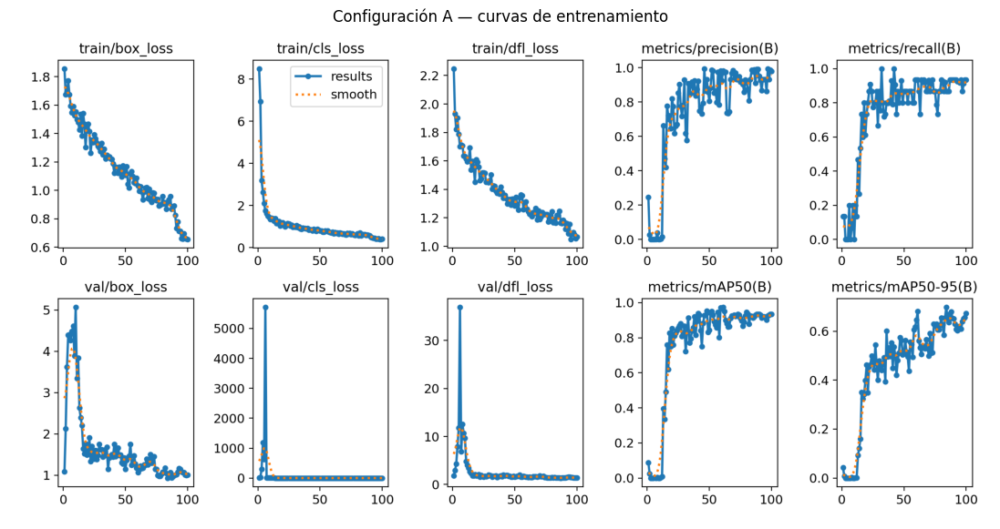

</details>

- **Las dos convergen y ninguna sobreajusta:** las pérdidas de validación se aplanan y no vuelven a subir.
- **B encuentra algo mejor las gorras** (mAP@50), **pero A ajusta mejor las cajas** (mAP@50-95, la métrica que elegimos como principal).
- **Con 45 fotos de entrenamiento, el modelo grande no tiene con qué aprovechar su capacidad extra.** Gana el más barato.

## 4. Prueba final y análisis de errores

Cada caja que predice el modelo se compara con el recuadro real usando **IoU**: el área en común dividida por el área total de las dos cajas.

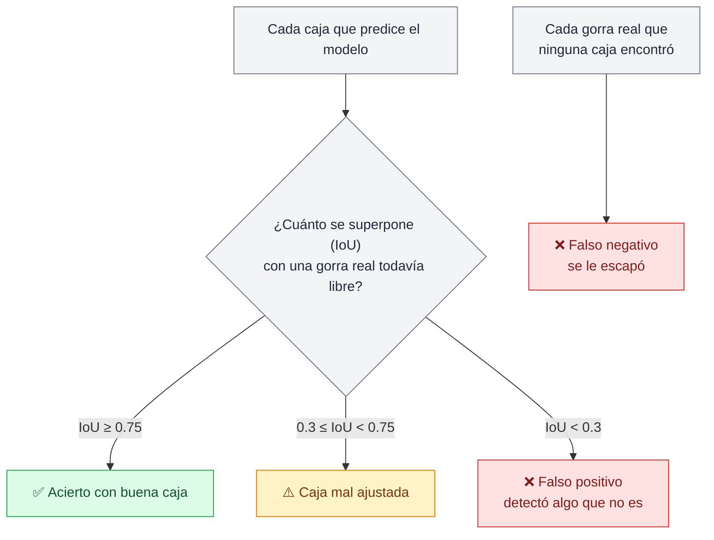

| | Test (7 gorras) | Valid (15 gorras) |
|---|---:|---:|
| ✅ Acierto con buena caja | 6 | 12 |
| ⚠️ Caja mal ajustada | 0 | 2 |
| ❌ Falso negativo | 1 | 1 |
| ❌ Falso positivo | 5 | 2 |

El detalle de cada predicción está en [`resultados/casos_test_valid.csv`](resultados/casos_test_valid.csv).

Dos fotos de test, con el recuadro real a la izquierda y la predicción a la derecha. Arriba aparecen dos falsos positivos sobre el borde oscuro de la tele; abajo, el modelo pierde la gorra gris clara:

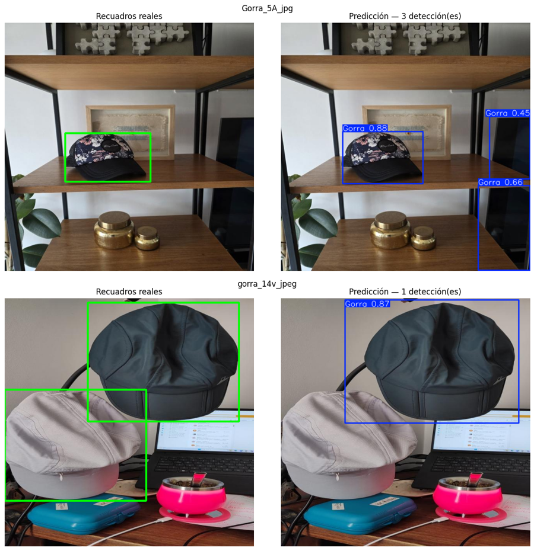

Un ejemplo de cada tipo (verde: recuadro real · rojo: predicción):

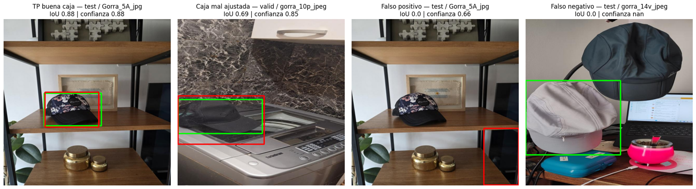

**In the wild:** tres fotos de exterior con sol fuerte y la gorra colgada. Acertó en 1 de 3.

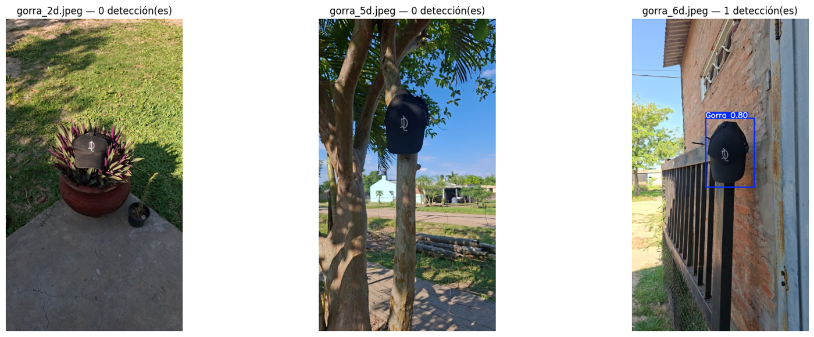

| Foto | Original (conf 0.25) | Estirada a 640x640 |
|---|---|---|
| `gorra_2d` | Falso negativo | Sigue sin detectar la gorra, más un falso positivo (0.41) |
| `gorra_5d` | Falso negativo | Sigue sin detectar la gorra, más 2 falsos positivos |
| `gorra_6d` | **Acierto** (0.80) | Acierto (0.85), más un falso positivo |

## Qué aprendimos

El detector funciona bien con fotos parecidas a las de entrenamiento y falla fuera de ellas. Encontramos cinco patrones:

1. **Oscuro = gorra.** La mayoría de las gorras del dataset son negras. Los falsos positivos caen sobre zonas oscuras (el borde de una tele, una sombra, hojas), y la gorra que se perdió es la gris clara.
2. **Pose.** Las gorras del dataset están casi siempre apoyadas. La gorra in the wild también es negra, pero colgada: no la detecta.
3. **El test es optimista.** La partición se hizo por foto, no por gorra, así que las mismas gorras aparecen en train y en test (la gorra floreada de test está en 8 fotos de train). Además, test viene estirado a 640x640 igual que train; las fotos nuevas no.
4. **Sensibilidad al umbral.** Una gorra chica entró con 0.29 de confianza (el umbral es 0.25) y los falsos positivos van de 0.32 a 0.66: un cambio chico de umbral cambia los resultados.
5. **Gorras cortadas por el borde** dan cajas mal ajustadas.

> **La precision de 0.987 no contradice los falsos positivos de test.** Ultralytics informa la precision en el umbral de confianza que da el mejor resultado, mientras que nosotros predecimos con 0.25.

**Qué haríamos distinto:** más gorras distintas (claras, de colores, colgadas, en exterior), fotos sin gorras con zonas oscuras, separar las particiones **por gorra**, reemplazar el flip vertical por cambios de brillo, y mantener la proporción de las fotos en lugar de estirarlas.

## Reproducir

> **Roboflow en el proyecto original vs. en este repo.** Durante el trabajo práctico usamos [Roboflow](https://roboflow.com/) para anotar las fotos, armar la partición, aplicar la aumentación y exportar el dataset, y el notebook original lo descargaba con una API key. Las fotos de prueba y los pesos entrenados estaban en el Google Drive del grupo.
>
> Para que cualquiera pueda reproducirlo sin cuentas ni permisos, este repo trae todo incluido: el export de Roboflow (versión 2) en `datos/dataset/`, las fotos de prueba en `datos/fotos_prueba/` y los pesos entrenados en `modelos/`. **No hace falta Roboflow, Google Drive ni ninguna API key:** se clona, se instalan las dependencias y se ejecuta.

**Requisitos:** Python 3.11 o superior (probado con 3.13) y `pip`. La GPU es opcional.

```bash
git clone https://github.com/javi2481/detector-gorras-yolo11.git
cd detector-gorras-yolo11
pip install -r requirements.txt
```

Después, abrir `notebooks/TP2_Detector_Gorras.ipynb` (VS Code, Jupyter o Colab) y *Reiniciar y ejecutar todo*.

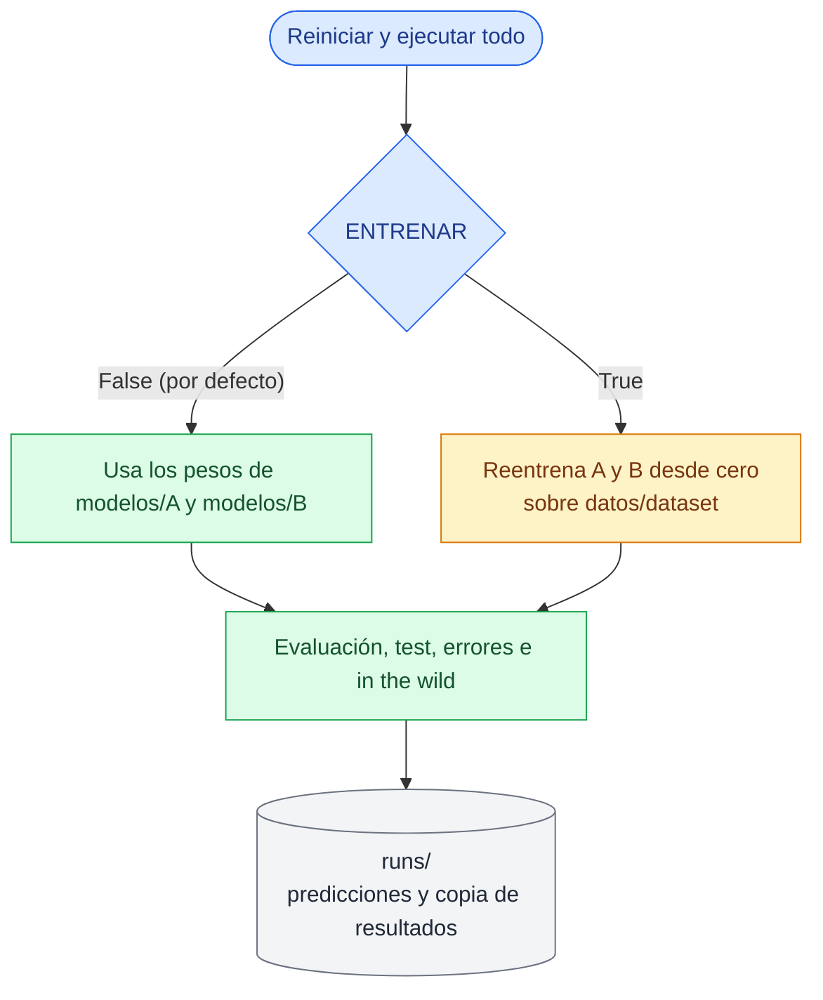

| Modo | Cómo se activa | Tiempo aproximado | Resultado |
|---|---|---|---|
| Pesos entrenados | `ENTRENAR = False` (por defecto) | Menos de 1 min, incluso en CPU | Las mismas métricas de la entrega |
| Reentrenar | `ENTRENAR = True` en la celda de configuración | ≈ 12 min con GPU · varias horas en CPU | Métricas muy parecidas; en CPU pueden variar levemente |

En Colab, si el notebook no encuentra la carpeta `datos/`, clona este repo automáticamente.

## Estructura del repositorio

```text
.
├── datos/
│   ├── dataset/                     # export de Roboflow v2 (formato YOLOv11)
│   │   ├── data.yaml                # rutas relativas y la clase "Gorra"
│   │   ├── train/                   # images/ + labels/ (180 imágenes aumentadas)
│   │   ├── valid/                   # images/ + labels/ (13 imágenes)
│   │   └── test/                    # images/ + labels/ (6 imágenes)
│   └── fotos_prueba/
│       ├── linea_base/              # 3 fotos para probar yolo11n.pt sin entrenar
│       └── in_the_wild/             # 3 fotos nuevas, fuera de todas las particiones
├── modelos/
│   ├── A/                           # yolo11n (ganador)
│   │   ├── weights/best.pt          # pesos entrenados
│   │   ├── results.csv              # pérdidas y métricas por época
│   │   ├── results.png              # curvas de entrenamiento
│   │   └── val_batch0_pred.jpg      # predicciones sobre un lote de validación
│   └── B/                           # yolo11s: weights/best.pt, results.csv, results.png
├── notebooks/
│   └── TP2_Detector_Gorras.ipynb    # notebook ejecutado, con todas las salidas
├── figuras/                         # imágenes de este README (salen del notebook)
├── resultados/
│   ├── tabla_A_vs_B.csv             # métricas de las dos configuraciones
│   └── casos_test_valid.csv         # cada predicción clasificada (TP / FP / FN / caja mal ajustada)
├── docs/
│   └── consigna.md                  # consigna del trabajo práctico
├── requirements.txt
├── LICENSE                          # licencia MIT
└── README.md
```

Al ejecutar el notebook se crea `runs/` (predicciones de Ultralytics y una copia de los resultados en `runs/entrega/`). Esa carpeta está en `.gitignore`.

Cómo se conectan las carpetas con el notebook:

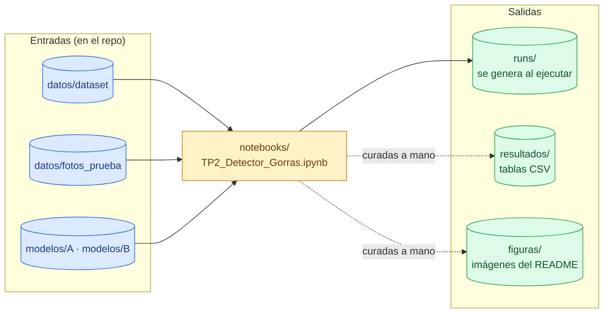

## El notebook, sección por sección

| Sección | Qué hace | Lee | Escribe |
|---|---|---|---|
| 0. Preparación del entorno | Instala dependencias y define rutas, semilla y `ENTRENAR` | — | — |
| 1. Dataset y anotación | Criterio de anotación, partición, estadísticas y ejemplos anotados | `datos/dataset` | `runs/data.yaml` |
| 2. Línea de base | Prueba `yolo11n.pt` sin entrenar sobre 3 fotos | `datos/fotos_prueba/linea_base` | `runs/detect/baseline` |
| 3. Fine-tuning | Configuraciones A y B, curvas y comparación | `modelos/` o `datos/dataset` | `runs/detect/train_*` (solo si `ENTRENAR = True`) |
| 4.1 – 4.3 Evaluación | Métricas sobre valid, inferencia sobre test y análisis de errores | `datos/dataset` | `runs/detect/val_*`, `runs/detect/test_ganador` |
| 4.4 In the wild | Inferencia sobre fotos nuevas, originales y estiradas | `datos/fotos_prueba/in_the_wild` | `runs/detect/in_the_wild` |
| 4.5 Guardado | Copia pesos, tablas y predicciones | `runs/` | `runs/entrega` |
| Reporte final | Problema, resultados, errores y conclusiones | — | — |

## Equipo

| Rol | Integrante | Responsabilidad |
|---|---|---|
| 1 | Mauricio Chocholacek | Roboflow: revisión de recuadros, partición, aumentación y exportación |
| 2 | Paola Lucia Pierolivo Fernandez | Criterio de anotación, estadísticas y línea de base |
| 3 | Veronica Andrea Gonzalez | Configuración A y comparación A vs. B |
| 4 | Daiana Marilyn Ruiz Díaz | Configuración B y fotos "in the wild" |
| 5 | Andrea Romeo | Inferencia sobre test y análisis de errores |
| 6 | Rodolfo Javier Berrone | Notebook final, introducción y conclusiones |

Así se repartió el trabajo a lo largo del proyecto:

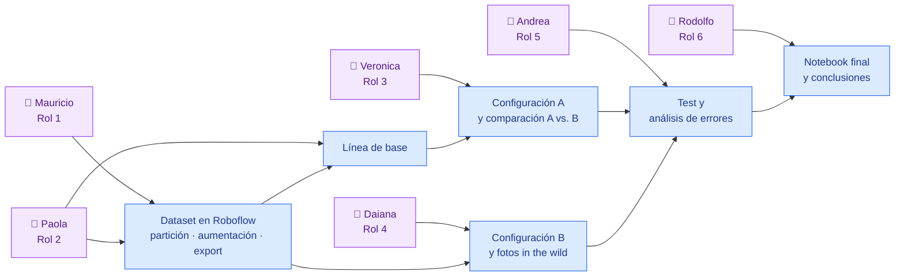

## Glosario rápido

| Término | Qué significa |
|---|---|
| **Fine-tuning** | Partir de un modelo ya entrenado y reentrenarlo con datos propios |
| **IoU** | Cuánto se superponen dos cajas: 1 si son idénticas, 0 si no se tocan |
| **Precision** | De lo que detectó, cuánto era gorra |
| **Recall** | De las gorras reales, cuántas encontró |
| **mAP@50** | Calidad de detección, contando como acierto una caja con IoU ≥ 0.5 |
| **mAP@50-95** | Lo mismo, pero exigiendo cajas cada vez más ajustadas |

## Créditos

- [Ultralytics YOLO11](https://docs.ultralytics.com/models/yolo11/): modelos pre-entrenados y entrenamiento.
- [Roboflow](https://roboflow.com/): anotación, partición, aumentación y exportación del dataset.
- Fotos tomadas y anotadas por el equipo.

## Licencia

Proyecto académico distribuido bajo la [licencia MIT](LICENSE).
